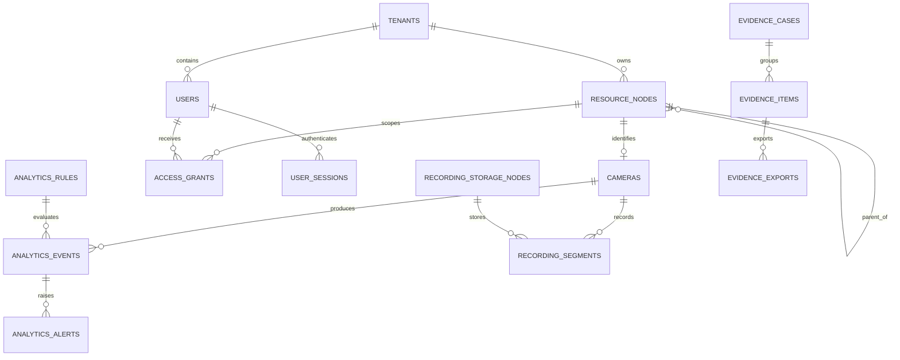

# Database entities and migrations

## Database technology

The control plane uses PostgreSQL through the `pg` package and a shared pool.
The initial schema uses UUID keys, `pgcrypto`, and PostgreSQL `ltree` for
hierarchical resource paths. Docker definitions supply PostgreSQL 16 or 17
depending on the selected Compose file. Redis is separately configured for
runtime state/event use; it is not a replacement for the PostgreSQL schema.

The repository includes 204 SQL files in `database/migrations/` at the time of
review. The migration runner also checks a legacy `backend/database/migrations/`
directory when present; no files were present there in this checkout.

## Core entities and relationships

The following is a domain-level overview, not a complete ER model of every
table added over the migration history.

| Domain | Representative entities | Relationship summary |
|---|---|---|
| Tenant and organization | `tenants`, `resource_nodes`, `branches` | A tenant owns resource nodes. Nodes form a parent/child hierarchy and carry path scope; camera records refer to resource nodes/branch nodes. |
| Identity and access | `users`, `user_sessions`, `role_permissions`, `user_organizational_assignments`, `access_grants`, `camera_specific_grants` | Users belong to a tenant; sessions and organization assignments reference users. Grants reference tenant, user, and resource scope. |
| Cameras and edge | `cameras`, `camera_credentials`, `device_inventory`, `device_identities`, `edge_agents`, edge telemetry/configuration records | Devices/cameras are associated with organization/branch scope; edge records represent deployed agents, assignments, releases, telemetry, and lifecycle data. |
| Analytics and alerts | `analytics_models`, `analytics_zones`, `analytics_rules`, `analytics_events`, `detected_objects`, `analytics_alerts`, alert/notification records | Rules and sources produce analytics events/detections; alert and notification entities retain operational state and delivery attempts. |
| Incidents and response | `live_incidents`, incident assignments/events/evidence references, playbooks and escalation records | Incidents associate response state with affected branches/cameras, evidence, audit, and alert workflows. |
| Recording and storage | `recording_jobs`, `recording_segments`, `recording_storage_nodes`, `recording_retention`, `recording_legal_holds`, recovery/index/failover records | Recording jobs/segments and indexes relate to cameras, storage nodes, retention policy, recovery, and legal holds. |
| Evidence and investigation | `evidence_cases`, `evidence_items`, `evidence_exports`, `evidence_manifests`, chain-of-custody and verification records | Cases group evidence; exports/manifests and custody records track derivatives and verification-related metadata. |
| Compliance and privacy | compliance frameworks/controls/assessments/findings, privacy controls/purposes/breaches, audit records | Governance records are linked by tenant, branch, camera, subject, or assessment identifiers as defined by their migrations. |
| Maintenance and health | maintenance assets, work orders, vendors, contracts, health snapshots, telemetry, connectivity and downtime records | Operational inventory and service/work-order records connect to affected assets/branches; health records capture observed state over time. |
| Platform operations | outbox/inbox, distributed leases, HA/DR, feature flags, federation and communication entities | Cross-cutting records support event delivery, coordination, configuration, availability, integrations, or communications. |

### Core ER diagram

This is a conceptual relationship diagram based on core schema and domain
structure. It intentionally omits columns, optionality, and many newer
relations; consult the specific migration SQL for exact constraints.

## Migration behavior

`scripts/run-migrations.mjs`:

1. Reads `.sql` filenames from the root migration directory and optional legacy
   directory, deduplicates by filename, and sorts with numeric-aware filename
   ordering.
2. Connects using `DATABASE_URL` and takes a PostgreSQL advisory lock.
3. Creates `schema_migrations` with filename, execution timestamp, SHA-256
   checksum, and elapsed time.
4. Can baseline selected portions of an existing core schema when the table is
   empty and recognizable schema objects already exist.
5. Applies each pending SQL file inside a transaction and records its checksum.
6. Reports applied, pending, and database-recorded migrations with no matching
   file using `npm run migrate:status`.

Checksum validation is **skipped by default**. Set
`SKIP_MIGRATION_CHECKSUM_VALIDATION=false` to enable the check. Once a migration
has shipped, add a new migration rather than editing the old SQL; enable
checksum validation in controlled deployment workflows.

The runner also treats certain “already exists” errors as an applied migration
after rollback and logs a warning. Review migration output; this compatibility
behavior is not proof that every intended statement took effect.

The Docker entrypoint runs the migration runner before starting the compiled
control plane. In Compose, PostgreSQL's `/docker-entrypoint-initdb.d` mount is
also present; PostgreSQL only runs that mechanism on initialization of an empty
data directory. Do not confuse that one-time image behavior with the
application's repeatable migration runner.

## Migration domains and source of truth

The migration series begins with core tenant/resource/camera/user/access
tables, then grows through authentication, camera grants, recording, analytics,
evidence, incidents, compliance, maintenance, privacy, operations, edge
lifecycle, storage/recovery, signed configuration, HA/DR, communications, and
date-stamped product updates. Files include both additive schema changes and
data/configuration changes; inspect each SQL file before applying it.

The canonical complete migration inventory and exact DDL are the files in
[`database/migrations/`](https://github.com/mohananpmalavika-dev/Omsystems/tree/main/database/migrations).
There are duplicate numeric prefixes and date-prefixed files, so use the
runner's actual sorted order rather than inferring order from a numeric prefix.

## Safe schema operations

- Snapshot and verify the target database before any production migration.
- Test migrations against a disposable database using `npm run migrate:test`
  where its prerequisites are available.
- Check `npm run migrate:status` and deployment logs.
- Do not edit or reorder migrations already applied to an environment.
- Run restore and destructive schema exercises only against explicitly
  identified non-production targets unless the approved recovery plan says
  otherwise.

For database backup and recovery, see [Operations](operations.md).
