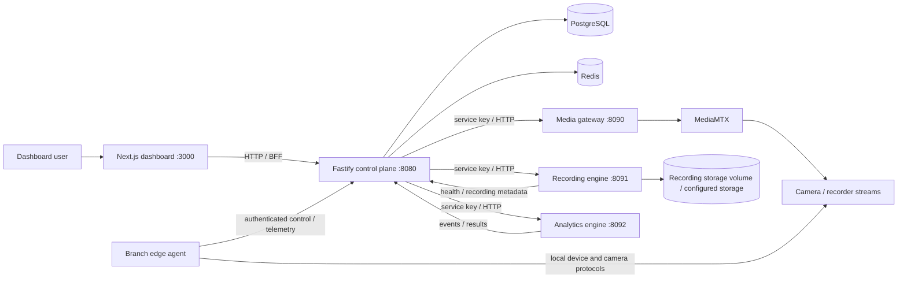
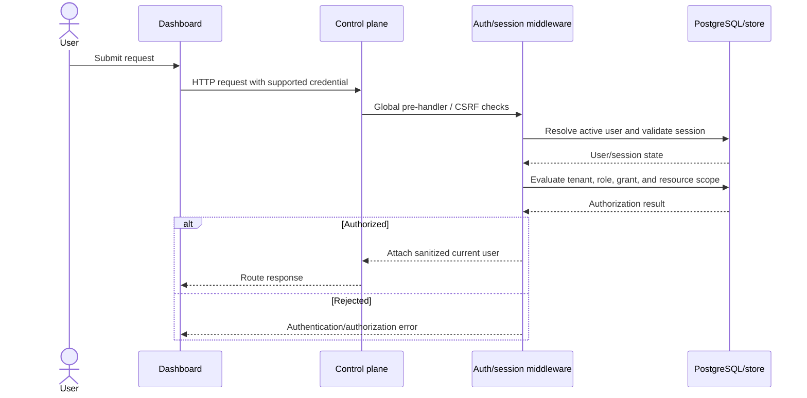
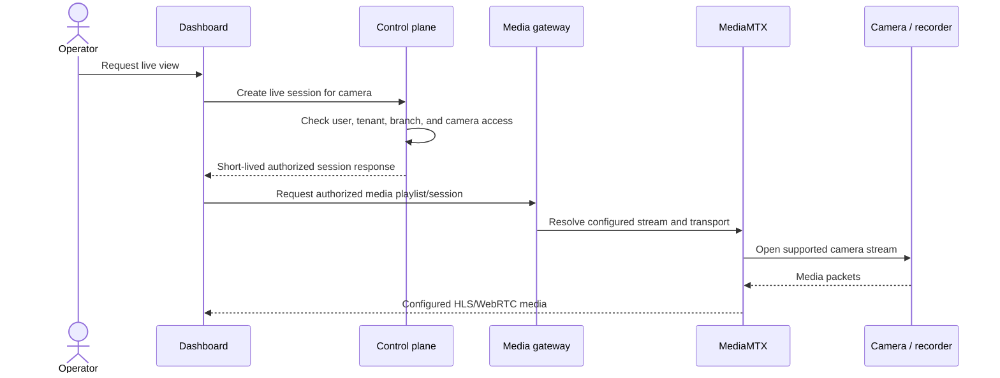
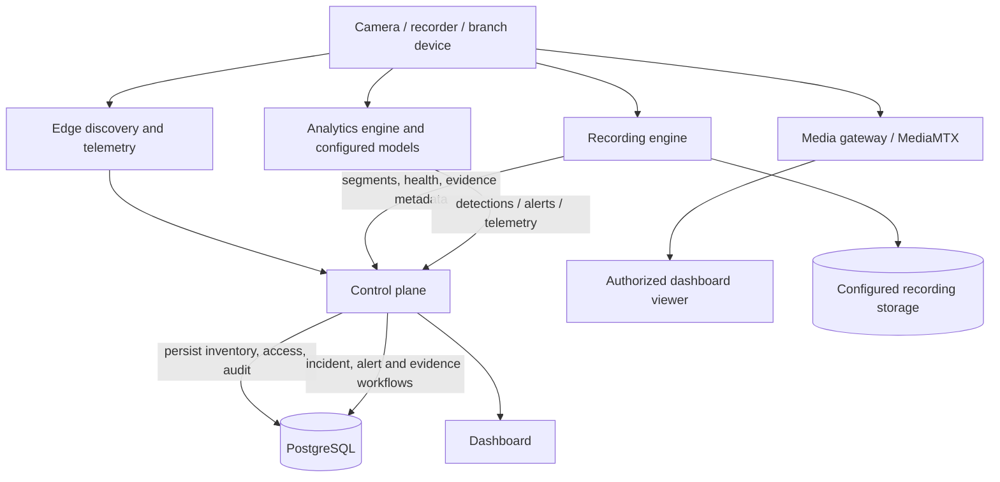

# Software Design Document (SDD)

## 1. Design summary

The system is a multi-process TypeScript application. A Fastify control plane
owns HTTP APIs and coordinates identity, authorization, persistence, and
operations. A Next.js dashboard provides the web UI. Separate services handle
media routing, recording/storage, and analytics. Branch-local edge agents
perform local discovery/monitoring and communicate with central services.
PostgreSQL is the durable schema store; Redis is present in the supplied
container definitions for shared runtime services.

The diagrams show repository-declared service boundaries and intended
interactions. They are logical views, not proof that every integration is
enabled in a given deployment.

## 2. Components and responsibilities

| Component | Entry point / source | Design responsibility |
|---|---|---|
| Control plane | `src/index.ts`, `src/app.ts` | Starts telemetry/config, database/store and runtime dependencies; builds Fastify app; registers API areas; starts HTTP/WebSocket service and graceful shutdown. |
| Dashboard | `dashboard/` | Next.js React application for operator and administrative pages; communicates with control-plane and service proxies. |
| Media gateway | `media-gateway/src/index.ts`, `media-gateway/src/app.ts` | Fastify media boundary with control-plane integration, access/session handling, and MediaMTX-facing HLS/WebRTC routes. |
| Recording engine | `recording-engine/src/index.ts` | Recording, storage adapters, retention, evidence capture, integrity, and recovery-oriented workflows. |
| Analytics engine | `analytics-engine/src/index.ts`, `analytics-engine/src/app.ts` | Detection/analytics pipeline, model usage, metrics, and incident/alert forwarding. |
| Edge agent | `edge-agent/src/index.ts` | Branch-side discovery, device health, media/runtime setup, telemetry/presence, and supported signed-update/configuration paths. |
| PostgreSQL | `database/migrations/`, `src/database/` | Relational system of record, migration history, and repository-backed access. |
| Redis | Compose service and runtime integrations | Shared runtime state/event integration where enabled. |
| MediaMTX | Compose service/config | Media streaming backend configured for HLS/WebRTC transport. |

## 3. Architecture diagram

Ports shown are the defaults in the root Compose file; production deployments
may override ports, addresses, and topology.

## 4. Runtime startup and readiness

The root control-plane process initializes telemetry and configuration,
establishes PostgreSQL and store behavior, initializes Redis-related services,
bootstraps modules, creates the Fastify application, binds its listener,
initializes WebSocket handling, and registers graceful shutdown. The container
entrypoint runs migrations before starting the compiled control plane.

The API has health/readiness routes and the supplied containers define health
checks for several services. A health endpoint only reports the component's
implemented check; it does not guarantee all integrations are healthy.

## 5. Request authorization flow

The middleware accepts bearer/session credentials and cookies; a development
header identity path also exists in source. Do not enable development-only
identity behavior in a production exposure.

## 6. Live media flow

The exact endpoint/token exchange and client transport are implemented across
service routes and can vary by configuration. This diagram is conceptual; use
the service contract and integration tests for exact wire-level details.

## 7. Data and event flow

## 8. Persistence and consistency

PostgreSQL SQL migrations define durable entities and schema evolution. The
migration runner records filename, checksum, execution duration, and timestamp
in `schema_migrations`; it serializes concurrent migration runs using an
advisory lock. Some state is handled by service-local or Redis-backed
components; the exact durability depends on the configured service and volume.
See [Database](database.md).

## 9. Deployment topology

The repository contains `compose.yaml`, a separate
`docker-compose.production.yml`, individual service Dockerfiles, Kubernetes
manifests, and platform deployment files. These are alternate deployment
artifacts, not a single unified installer. Validate the selected topology,
environment, image artifacts, ingress, storage, and operational procedures
before deployment.

## 10. Design constraints and limitations

- Runtime behavior is split across multiple services and requires compatible
  service URLs/shared keys.
- The control-plane Docker build requires a separately supplied Windows edge
  release.
- Live streaming and analytics depend on device, model, and external service
  prerequisites.
- The route modules and OpenAPI contract have different coverage; see [API](api.md).
- No repository evidence was found to establish production SLO/SLA values,
  formal threat-model approval, or recovery objectives.
